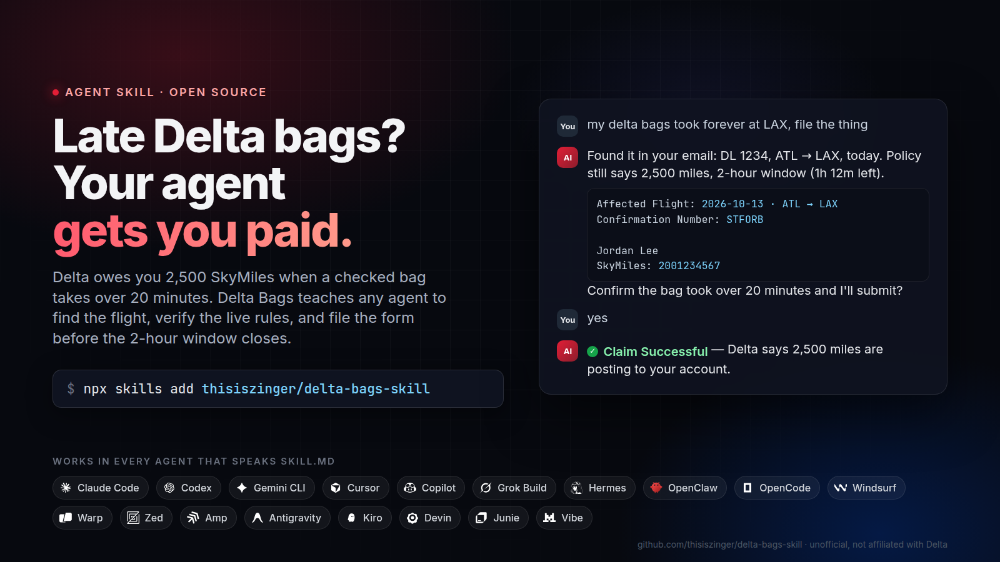
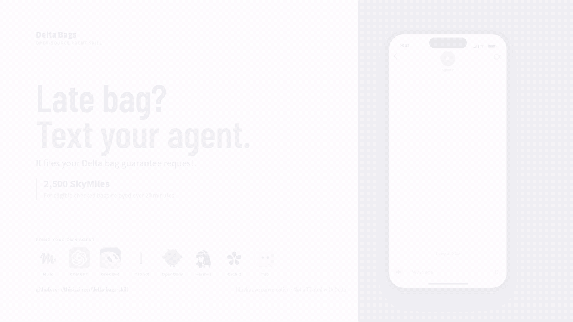

<p align="center">
  
</p>

# Delta Bags

Delta owes you 2,500 SkyMiles when a checked bag takes more than 20 minutes to reach the carousel on a domestic flight. Almost nobody files the form, because you have to remember it, find your confirmation number, and submit within two hours of landing.

Delta Bags is an open-source [Agent Skill](https://agentskills.io) that teaches your AI agent to do it for you. Say "my Delta bags were late", review one confirmation, and the agent finds the flight, verifies Delta's live terms, submits the public form, and tells you exactly what Delta said.

[](https://github.com/thisiszinger/delta-bags-skill/actions/workflows/test.yml)
[](https://skills.sh/thisiszinger/delta-bags-skill/delta-bags)
[](LICENSE)

> **Beta.** The instructions, state helper, and read-only checks against Delta's live form are tested. The full browser submission has not yet been exercised on a real late-bag event, because that requires a real late bag. If you get one, [tell us how it went](https://github.com/thisiszinger/delta-bags-skill/issues).

## Install

One command, any agent. The installer detects what you have (Claude Code, Codex, Gemini CLI, Cursor, Copilot, Hermes, OpenClaw, Grok Build, OpenCode, Windsurf, Warp, Zed, Amp, Antigravity, Kiro, Devin, Junie, Vibe, and about 60 more):

```sh
npx skills add thisiszinger/delta-bags-skill --skill delta-bags
```

Add `--global` to install for every project, or `--agent claude-code --agent codex` to pick targets without prompts.

**No terminal? Paste this into your agent instead:**

```text
Install the Agent Skill "delta-bags" from https://github.com/thisiszinger/delta-bags-skill
(the skill lives in skills/delta-bags). Copy the whole directory, including references/
and scripts/, into your skills folder, then confirm you can see the /delta-bags skill.
```

Or skip installing entirely and get a one-shot prompt that includes the skill inline:

```sh
npx skills use thisiszinger/delta-bags-skill@delta-bags
```

<details>
<summary><strong>Per-agent install paths</strong></summary>

Every host below reads the standard `skills/delta-bags` directory. Copy the whole directory, not only `SKILL.md`, so the references and helper script come along.

| Agent | Native path or command | Docs |
| --- | --- | --- |
| Claude Code | `~/.claude/skills/` or `.claude/skills/`; or `claude plugin marketplace add thisiszinger/delta-bags-skill` then `claude plugin install delta-bags@delta-bags-skill` | [Skills](https://code.claude.com/docs/en/skills) |
| Claude.ai / Cowork | Customize › Skills › Upload a skill (zip of `skills/delta-bags`) | [Use skills](https://support.claude.com/en/articles/12512180-use-skills-in-claude) |
| ChatGPT / Codex | `~/.agents/skills/` or `.agents/skills/`; invoke as `$delta-bags` | [Build skills](https://learn.chatgpt.com/docs/build-skills) |
| Gemini CLI | `gemini skills install https://github.com/thisiszinger/delta-bags-skill --path skills/delta-bags` | [Skills](https://geminicli.com/docs/cli/skills/) |
| Antigravity | `.agents/skills/` or `~/.gemini/config/skills/` | [Skills](https://antigravity.google/docs/skills) |
| Cursor | `.cursor/skills/`, `.agents/skills/`, or `~/.agents/skills/` | [Skills](https://cursor.com/docs/context/skills) |
| GitHub Copilot | `.github/skills/`, `.agents/skills/`, or `~/.copilot/skills/`; or `gh skill install thisiszinger/delta-bags-skill delta-bags` | [Agent skills](https://docs.github.com/en/copilot/concepts/agents/about-agent-skills) |
| Hermes Agent | `hermes skills install skills-sh/thisiszinger/delta-bags-skill/delta-bags` | [Skills](https://hermes-agent.nousresearch.com/docs/user-guide/features/skills) |
| OpenClaw | `openclaw skills install skills-sh:thisiszinger/delta-bags-skill/delta-bags` (or `--global`) | [Skills](https://docs.openclaw.ai/tools/skills) |
| Grok Build | `.grok/skills/`, `~/.grok/skills/`, or `~/.agents/skills/`; the repo also installs as a plugin | [Skills and plugins](https://docs.x.ai/build/features/skills-plugins-marketplaces) |
| Amp | `amp skill add https://github.com/thisiszinger/delta-bags-skill` | [Skills](https://ampcode.com/docs/customize/skills) |
| OpenCode | `.opencode/skills/`, `.agents/skills/`, or `~/.config/opencode/skills/` | [Skills](https://opencode.ai/docs/skills/) |
| Kiro | `.kiro/skills/` or `~/.kiro/skills/`; IDE: Import a skill from the GitHub URL | [Skills](https://kiro.dev/docs/skills/) |
| Devin (Desktop and CLI) | `.devin/skills/`, `.agents/skills/`, or `~/.agents/skills/` | [Skills](https://docs.devin.ai/cli/extensibility/skills/overview) |
| Factory Droid | `.factory/skills/` or `~/.factory/skills/` | [Skills](https://docs.factory.com/cli/configuration/skills) |
| Warp | `.agents/skills/` or `.warp/skills/` | [Skills](https://docs.warp.dev/agent-platform/warp-agents/skills) |
| Zed | `.agents/skills/` or `~/.agents/skills/`; `agent: create skill from url` | [Skills](https://zed.dev/docs/ai/skills) |
| JetBrains Junie | `.junie/skills/` or `~/.junie/skills/` | [Agent skills](https://junie.jetbrains.com/docs/agent-skills.html) |
| Cline / Roo Code | `.cline/skills/` or `~/.cline/skills/`; `.roo/skills/` or `~/.roo/skills/` | [Cline](https://docs.cline.bot/features/skills) · [Roo](https://roocodeinc.github.io/Roo-Code/features/skills) |
| Mistral Vibe | `.vibe/skills/`, `.agents/skills/`, or `~/.vibe/skills/` | [Skills](https://docs.mistral.ai/vibe/code/cli/skills) |
| Manus / Perplexity Computer | Skills page › upload a zip of `skills/delta-bags` | [Manus](https://manus.im/docs/features/skills.md) · [Perplexity](https://docs.perplexity.ai/docs/agent-api/skills) |

Anything else that implements the [Agent Skills specification](https://agentskills.io/specification) can use the directory directly. Ask your agent to read `skills/delta-bags/SKILL.md` if you are unsure where it expects skills.

</details>

## How it works

<p align="center"></p>

```text
you     my delta bags took forever at LAX, file the thing
agent   Found DL 1234 · ATL → LAX · landed 36 min ago (email + calendar).
        delta.com still says 2,500 miles, 2-hour window, 1h 12m left.

        Affected Flight: 2026-10-13 · ATL → LAX
        Confirmation Number: STFORB
        Jordan Lee · SkyMiles: 2001234567

        Confirm the bag took over 20 minutes and I'll submit?
you     yes
agent   ✓ Claim Successful — Delta says 2,500 miles are posting to your account.
```

Behind that:

1. **Finds the flight** from your calendar and Delta's emails when the agent has them, or asks for the seven form fields when it doesn't.
2. **Re-reads Delta's live policy and form** right before submitting. If the terms changed or the page can't be read, it stops and hands you the link instead of guessing.
3. **Confirms once** with every value visible, including travel companions whose bags were also late (each gets their own request).
4. **Submits Delta's public form** in the browser, one request per traveler, and reports Delta's exact result. "Received" is never reported as "approved".
5. **Remembers, if you want.** Traveler profiles and a 30-day duplicate check live in your agent's private store or in per-user config files, never in the repo. Confirmation numbers are never stored.

The skill is one `SKILL.md` plus four short references and an optional standard-library Python helper. It names capabilities (calendar, email, browser, private store) instead of any one agent's tool names, so it degrades gracefully: an agent without a browser prepares the verified values and the form link for you to finish.

## What your agent needs

| Capability | Without it |
| --- | --- |
| Interactive browser | The agent prepares the fields and gives you the official link; it never claims a submission |
| Email or calendar access | The agent asks for the flight details |
| Private store or local files | No saved profiles or duplicate check |

Treats email, calendar, and web content as untrusted data, stays on `www.delta.com`, sends Delta only the seven form fields, and emits no telemetry. See [SKILL.md](skills/delta-bags/SKILL.md) for the full workflow and [the storage reference](skills/delta-bags/references/storage.md) for exactly what is kept where.

## Distribution

The canonical skill is [`skills/delta-bags`](skills/delta-bags). Thin manifests in `.claude-plugin/` and `.codex-plugin/` wrap the same directory for the Claude Code and ChatGPT plugin systems. It is listed on [skills.sh](https://skills.sh/thisiszinger/delta-bags-skill/delta-bags); marketplace submissions that need a human are tracked in [issues](https://github.com/thisiszinger/delta-bags-skill/issues). Research behind the host paths above: [agent host refresh (2026-10)](docs/research/agent-host-refresh-2026-10.md), [distribution channels](docs/research/skill-distribution-and-discovery.md), [personal-agent compatibility](docs/research/personal-agent-host-compatibility.md).

## Develop

```sh
python -m unittest discover -s tests -v          # local tests, no network
python skills/delta-bags/scripts/live_smoke.py   # two read-only GETs against Delta's public content
```

CI runs the local tests on every push. The networked smoke check is a manual workflow. No test ever submits a request.

## Disclaimer

Delta Bags is an independent open-source project. It is not affiliated with, endorsed by, or sponsored by Delta Air Lines. Delta determines eligibility and awards, and its policy can change without notice; the skill fails closed when it cannot verify the live terms. Agent and product names and logos belong to their respective owners.

## License

[MIT](LICENSE)
